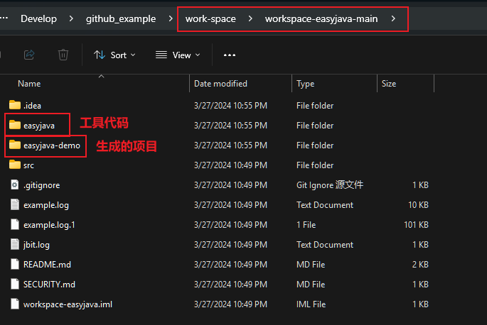

# mybatis generation tool | mybatis 生成工具

### 📝 使用方法

1. 点击 Code 下载对应的 zip 压缩包到你的电脑上，新建一个文件夹，名称随意起，我这里使用 work-space，将 zip 解压到文件夹中，使用 IDEA 导入项目（导入过程很简答，已省略）
2. easyjava 项目结构

```java
Folder PATH listing
Volume serial number is 0000021B 53A5:9BDE
D:.
│  .gitignore
│  list.txt
│  pom.xml -----------------------------------------  maven 依赖
│  
└─src
    └─main
        ├─java
        │  └─com
        │      └─easyjava
        │          │  RunApplication.java ---------- 运行主类，点击运行即可生成 MyBatis 基础项目
        │          │  
        │          ├─bean
        │          │      Constants.java  ---------- 固定常量，不变的
        │          │      FieldInfo.java  ---------- 文件信息
        │          │      TableInfo.java  ---------- 数据表信息
        │          │      
        │          ├─builder
        │          │      BuildBase.java  ---------- 建立 MyBatis 基础类
        │          │      BuildComment.java -------- 创建类的注释
        │          │      BuildController.java ----- 创建控制器
        │          │      BuildMapper.java --------- 创建 Mapper 类
        │          │      BuildMapperXml.java ------ 创建 MapperXml 类
        │          │      BuildPo.java ------------- 创建 Po 类
        │          │      BuildQuery.java ---------- 创建 表查询属性
        │          │      BuildService.java -------- 创建 Service 类
        │          │      BuildServiceImpl.java ---- 创建 ServiceImpl 接口类
        │          │      BuildTable.java ---------- 读取表，以及表的部分处理
        │          │      DateUtils.java ----------- 时间格式
        │          │      
        │          └─utils
        │                  JsonUtils.java ---------- Json格式转化工具类
        │                  PropertiesUtils.java ---- 读取数据库配置类
        │                  StringUtils.java -------- 字符串处理工具类
        │                  
        └─resources
            │  application.properties -------------- 数据库配置和生成参数
            │  log4j.properties -------------------- 日志配置文件
            │  
            └─template ----------------------------- 固定模板类
                    ABaseController.txt ------------ 基础控制器类
                    AGlobalExceptionHandlerController.txt - 全局异常控制器文件
                    BaseMapper.txt ----------------- 基础 Mappeer 类
                    BaseQuery.txt ------------------ 基础分页属性类
                    BusinessException.txt ---------- 业务处理异常分类
                    DateTimePatternEnum.txt -------- 时间格式化类
                    DateUtils.txt ------------------ 时间工具类
                    PageSize.txt ------------------- 页面大小类
                    PaginationResultVO.txt --------- 页面响应结果类
                    ResponseCodeEnum.txt ----------- 页面响应枚举类
                    ResponseVO.txt ----------------- 页面响应类
                    SimplePage.txt ----------------- 页面基础类
```

3.删除 easyjava-demo 文件夹（之前生成好的，也可以保留）

<div align="center" style="display: flex; justify-content: center; align-items: center; flex-direction: column;">
    
</div>

1. 在 IDEA 中找到 application.properties 这个文件，修改你数据库的配置

```java
# 数据库配置属性
db.driver.name=com.mysql.cj.jdbc.Driver
db.url=jdbc:mysql://localhost:3306/test?useUnicode=true&characterEncoding=utf-8&useSSL=false
db.username=root
db.password=root
```

> 不同的数据库 url 不一样，自行修改，同时修改自己数据库的(db.usernam)用户名(db.password)和密码和表名(test)
> 

5.修改项目生成路径，同样还是 application.properties 里面找到配置自己项目的路径

```java
# 文件输出路径
path.base=D:/Develop/work-develop/workspace-easyjava/easyjava-demo/src/main/
```

> 注意：这里路径只用于第一次生成，后面不能再使用，因为会覆盖后面修改的代码！！！！
解决方法：可以修改路径生成新的项目，然后修改对应的内容
> 
1. 生成项目的目录结构（以 easyjava-demo）

```java
Folder PATH listing
Volume serial number is 00000254 53A5:9BDE
D:.
│  .gitignore
│  list.txt
│  pom.xml
│  
└─src
    └─main
        ├─java
        │  └─com
        │      └─easyjava
        │          │  RunDemoApplication.java
        │          │  
        │          ├─controller
        │          │      ABaseController.java
        │          │      AGlobalExceptionHandlerController.java
        │          │      ProductInfoController.java
        │          │      
        │          ├─entity
        │          │  ├─po
        │          │  │      ProductInfo.java
        │          │  │      
        │          │  ├─query
        │          │  │      BaseQuery.java
        │          │  │      ProductInfoQuery.java
        │          │  │      SimplePage.java
        │          │  │      
        │          │  └─vo
        │          │          PaginationResultVO.java
        │          │          ResponseVO.java
        │          │          
        │          ├─enums
        │          │      DateTimePatternEnum.java
        │          │      PageSize.java
        │          │      ResponseCodeEnum.java
        │          │      
        │          ├─exception
        │          │      BusinessException.java
        │          │      
        │          ├─mappers
        │          │      BaseMapper.java
        │          │      ProductInfoMapper.java
        │          │      
        │          ├─service
        │          │  │  ProductInfoService.java
        │          │  │  
        │          │  └─impl
        │          │          ProductInfoServiceImpl.java
        │          │          
        │          └─utils
        │                  DateUtils.java
        │                  
        └─resources
            │  application.properties
            │  logback-spring.xml
            │  
            └─com
                └─easyjava
                    └─mappers
                            ProductInfoMapper.xml
                            

```

1. 如果还是不放心可以测试 easyjava-demo 实现生成的项目，先测试没问题再生成自己的项目，数据库文件放在 github 项目页面的根目录，会一同与 zip 打包下载
